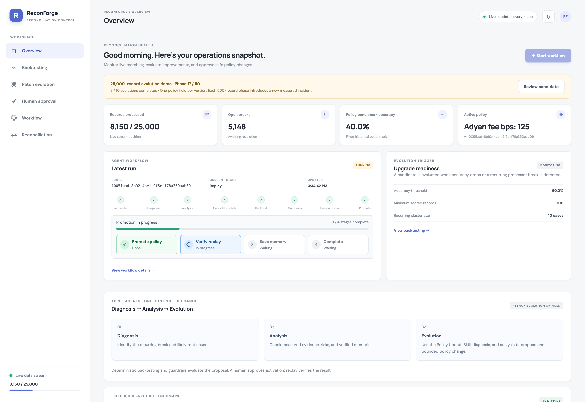
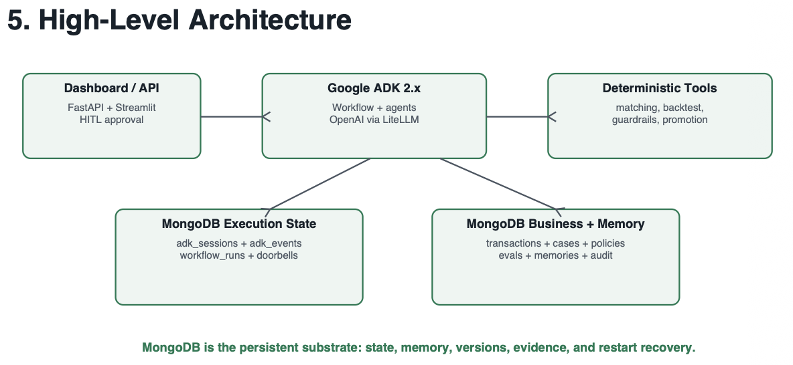

# ReconForge

ReconForge demonstrates governed policy evolution for transaction reconciliation. It matches internal ledger records to processor settlements, diagnoses recurring breaks, and proposes small policy updates. Independent evaluation and human approval control which changes become active.

## Extended demo with recorded approval

**[Watch the extended demo — 4:00](reconforge-demo-extended.mp4)**

The original three-minute walkthrough is followed by one minute of actual approval footage with narration. The appended segment records an operator approving Adyen's settlement-window update from two to five business days, the approval acknowledgement, and the four-stage promotion panel. The verified completion card summarizes the saved outcome: replay passed, memory saved, and historical benchmark accuracy increased from **45% to 50%**. Waiting periods are condensed.

[Approval segment only — 1:00](reconforge-approval-process.mp4) · [Verified outcome](artifacts/demo/approval-outcome.json) · [Approval narration transcript](artifacts/demo/approval-narration.txt)

The approval confirmation now appears only within Human approval and disappears after completion; duplicate/global top banners have been removed.

## Three-minute video demo

[](reconforge-demo-3min.mp4)

**[Watch or download the narrated video — 3:00](reconforge-demo-3min.mp4)**

The video includes the dashboard, human approval, backtesting, policy versions, parameter changes, and measured accuracy improvements. It uses the real application UI, English synthetic narration, and an embedded English subtitle track. The recorded run shows approved historical benchmark accuracy increasing from **20% to 40%**, with a **45% candidate awaiting approval**. These are synthetic demo results, not production performance claims.

- [Narration audio](reconforge-narration-3min.m4a)
- [Narration transcript](artifacts/demo/narration.txt)
- [Subtitle file](artifacts/demo/reconforge-demo-3min.srt)

## How it works

1. **Reconcile:** deterministic rules compare transaction identity, references, amounts, dates, and allocation.
2. **Diagnose:** an agent identifies a recurring failure and its likely cause.
3. **Analyse:** an agent reviews evidence, risks, and verified memories.
4. **Evolve:** an agent consults the policy skill and rules to propose one supported parameter change.
5. **Backtest:** an independent evaluator measures the candidate against the current policy and checks fixed guardrails.
6. **Approve:** an operator reviews a red/green diff, line numbers, current live accuracy, and active/candidate backtest accuracy.
7. **Promote and verify:** the saved decision resumes the workflow in the background. The UI tracks policy promotion, held-out replay, memory save, and completion. Failed verification can trigger rollback.

Ingestion runs independently of agent execution and human approval. The default pace is **10 records every five seconds**. Approval confirmation stays tied to its workflow rather than disappearing when a newer candidate appears.

## Policies and dataset

The synthetic live stream contains **25,000 transaction pairs**; the separate historical benchmark contains **8,000 pairs**. The existing dataset directory retains its original name: `ReconForge_Scale5000_Dataset/`.

Four processor labels—**Stripe, Adyen, PayPal, and Square**—have explicit policy parameters. They are demonstration labels, not connections to those payment services.

Supported evolution parameters include amount tolerance, settlement windows, fixed fees, and percentage fees. Each proposal changes one field on one processor. Dataset scenarios interleave these failure types and include reference errors, identity mismatches, weekend/date boundaries, and duplicate allocation ambiguity. Evidence-based incident selection prefers a different supported parameter after a completed update.

Offline validation checks ten single-field improvements on the fixed historical benchmark, from **20% to 70%** in five-point steps. This does not mean ten approvals have happened in the running app. Live-prefix accuracy can fluctuate as new records arrive, and candidate gains remain unapproved until the operator acts. Python code and fuzzy-reference evolution are **on hold**.

| File | Purpose |
| --- | --- |
| [policy.json](app/evolution_patches/policies/policy.json) | Local baseline with explicit processor settings |
| [Policy Update Skill](app/evolution_patches/policies/policy_skill/SKILL.md) | Evidence-driven proposal procedure |
| [rules.json](app/evolution_patches/policies/policy_skill/rules.json) | Allowed parameters, paths, and bounds |
| [Dataset documentation](docs/scale5000.md) | Scenario generation and validation |
| [Validation results](docs/scale5000_validation.json) | Measured offline evolution results |

The local policy remains the baseline. Promoted policies and their parent versions are maintained in MongoDB.

## Run locally

Requirements: Python 3.11+, [uv](https://docs.astral.sh/uv/), Node.js 20+, npm, and MongoDB. Agent workflows require a Gemini or Nicrron API key.

```bash
cp .env.example .env
uv sync
```

Configure the following in `.env`, keeping credentials private:

```dotenv
MONGODB_URI=<your-mongodb-uri>
MONGODB_DB=reconforge_long_horizon
DATASET_DIR=ReconForge_Scale5000_Dataset
MODEL_PROVIDER=nicrron
NICRRON_API_KEY=<your-api-key>
NICRRON_BASE_URL=https://api.nicrron.ai/v1
NICRRON_MODEL=openai/gpt-5-mini
```

For Gemini, use `MODEL_PROVIDER=gemini` and set `GOOGLE_API_KEY` instead.

Build the frontend, then start the API from the repository root:

```bash
npm --prefix frontend ci
npm --prefix frontend run build
uv run uvicorn app.api:app --host 127.0.0.1 --port 8001
```

Open **http://127.0.0.1:8001**. API documentation is at **http://127.0.0.1:8001/docs**. Startup initializes the baseline and stream state without copying the raw fixture dataset into MongoDB. Use a fresh database for a different dataset; existing policy versions are immutable.

For frontend development, run the API on port 8000 and run `npm run dev` inside `frontend/`. Vite proxies API requests to port 8000.

## Storage and recovery

MongoDB retains policy versions, workflow outcomes, approvals, evaluation results, verified memories, reconciliation results, and audit records. Pending workflow checkpoints and unconsumed signals remain available for recovery. Routine telemetry and completed execution traces expire after seven days.

Raw ledger fixtures, settlements, and evaluation labels remain local. A dataset fingerprint prevents accidental fixture changes in an existing database. Preserve the dataset files for reproducible replay. See [storage and retention](docs/storage.md).

## Evaluation safeguards

Candidates must satisfy fixed checks, including a minimum 1,000-record sample, bounded false-match rates, no regressions of previously correct matches, no high-value false matches, and a minimum three-point improvement in correct auto-resolution. Agents cannot edit these safeguards. Implementation: [business checks](app/tools/business.py), [guardrails](app/tools/guardrails.py).

Useful endpoints:

- `GET /health` — configuration and server status
- `GET /dashboard` — dashboard state
- `POST /demo/seed` — idempotent initialization
- `POST /runs/start` — start an evaluation workflow
- `POST /runs/{run_id}/approval` — record an approval or rejection
- `GET /runs/{run_id}` — follow processing after the decision is saved

## Architecture references

[Agent details](docs/agents.md) · [Evolution artifacts](app/evolution_patches/README.md)



The architecture images describe the overall flow; the current frontend is React/Vite, served by FastAPI in production. Current storage behavior is documented above.
